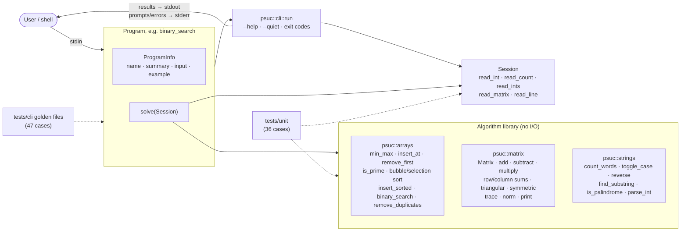

# PSUC IA-2: Lab Programs in C++


Solutions to the **Problem Solving Using C++ (PSUC) internal assessment 2 lab sheet**: 1-D arrays, 2-D arrays and strings. There are 21 small command-line programs. All of them share one tested algorithm library, and each validates its input.

---

## Contents

- [Overview](#overview)
- [Features](#features)
- [Exercise index](#exercise-index)
- [Tech stack](#tech-stack)
- [Architecture](#architecture)
- [Project structure](#project-structure)
- [Getting started](#getting-started)
- [Usage](#usage)
- [Configuration](#configuration)
- [Commands reference](#commands-reference)
- [Testing](#testing)
- [Linting and formatting](#linting-and-formatting)
- [Installing / deployment](#installing--deployment)
- [Troubleshooting / FAQ](#troubleshooting--faq)
- [Known limitations and roadmap](#known-limitations-and-roadmap)
- [Contributing](#contributing)
- [License](#license)

---

## Overview

The lab sheet asks for a set of classic beginner exercises: finding the minimum and maximum, inserting and deleting, sorting, binary search, matrix arithmetic, triangular and symmetric checks, and string handling without library string functions. This repository started as one notes file of answers pasted in by hand. Several answers were wrong (for example, the "matrix multiplication" multiplied element by element, and the "toggle case" program reversed the string). Others overflowed on larger input, and two exercises had no answer at all.

The project now:

- **implements every exercise correctly** and keeps each technique visible. Loops, swaps, and binary search are written out by hand rather than replaced by `<algorithm>` calls.
- **separates the logic from the I/O.** The algorithms live in a small library (`include/psuc`, `src/lib`), so they can be unit tested.
- **behaves like a well-mannered CLI.** Every program has `--help`, clear error messages and meaningful exit codes, and works both interactively and with piped input.

It is aimed at **students** studying for the same lab or exam who want reference answers they can trust, and at **reviewers** who want a compact example of a tested, warning-clean C++20 project.

## Features

- **21 programs**: all lab exercises, plus a bonus string-reverse program.
- **Input validation**: non-numbers, sizes out of range, a negative or over-large index, unsorted input to binary search or sorted insert, and mismatched matrix dimensions all produce a clear `error:` message and exit code `1`.
- **No fixed-size buffers**: `std::vector`/`std::string` replace `int arr[50]`, `int a[100][100]` and `char str[30]`, which silently overflowed or truncated before. Sizes are capped at 100 000 elements and 500 × 500 matrices.
- **Prompts that do not pollute output**: prompts appear on **stderr** only when stdin is a terminal. Use `program < input.txt > output.txt` for clean results, or `--quiet` to always hide them.
- **The string lab stays true to its rule**: Lab 6 says "without using string-handling functions", so `strlen`, `strstr`, `toupper` and `std::stoi` are not used. Every character is handled by hand.
- **Overflow-safe arithmetic** where it matters: the primality test uses `d <= n / d`, the string-to-int converter detects 64-bit overflow, and values are 64-bit (`long long`).
- **69 automated tests** (unit, end-to-end golden-file, and `--help` smoke tests). They pass under GCC, Clang, and AddressSanitizer/UBSan.
- **Strict tooling**: `-Wall -Wextra -Wpedantic -Wconversion -Wshadow … -Werror`, `clang-format`, and `clang-tidy` (bugprone, cppcoreguidelines, modernize, performance and readability checks).

## Exercise index

| Lab | # | Exercise | Program | Source |
|-----|---|----------|---------|--------|
| 4 · 1-D arrays | 1 | Largest and smallest element | `min_max` | [min_max.cpp](src/programs/lab4_1d_arrays/min_max.cpp) |
| | 2a | Insert an element at a position | `insert_element` | [insert_element.cpp](src/programs/lab4_1d_arrays/insert_element.cpp) |
| | 2b | Delete an element | `delete_element` | [delete_element.cpp](src/programs/lab4_1d_arrays/delete_element.cpp) |
| | 3 | Print all prime numbers | `primes` | [primes.cpp](src/programs/lab4_1d_arrays/primes.cpp) |
| | 4 | Ascending/descending with bubble or selection sort | `array_sort` | [array_sort.cpp](src/programs/lab4_1d_arrays/array_sort.cpp) |
| | 5 | Insert into a sorted array (stays sorted) | `sorted_insert` | [sorted_insert.cpp](src/programs/lab4_1d_arrays/sorted_insert.cpp) |
| | 6 | Binary search | `binary_search` | [binary_search.cpp](src/programs/lab4_1d_arrays/binary_search.cpp) |
| | 7 | Delete all duplicates (`[3,4,1,3,5,5,3]` → `[3,4,1,5]`) | `remove_duplicates` | [remove_duplicates.cpp](src/programs/lab4_1d_arrays/remove_duplicates.cpp) |
| 5 · 2-D arrays | 1 | Add and subtract two matrices | `matrix_add_subtract` | [matrix_add_subtract.cpp](src/programs/lab5_2d_arrays/matrix_add_subtract.cpp) |
| | 2 | Multiply two matrices | `matrix_multiply` | [matrix_multiply.cpp](src/programs/lab5_2d_arrays/matrix_multiply.cpp) |
| | 3 | Row sums and column sums | `row_column_sum` | [row_column_sum.cpp](src/programs/lab5_2d_arrays/row_column_sum.cpp) |
| | 4a | Lower triangular check | `lower_triangular` | [lower_triangular.cpp](src/programs/lab5_2d_arrays/lower_triangular.cpp) |
| | 4b | Upper triangular check | `upper_triangular` | [upper_triangular.cpp](src/programs/lab5_2d_arrays/upper_triangular.cpp) |
| | 5 | Symmetric check (A = Aᵀ) | `symmetric` | [symmetric.cpp](src/programs/lab5_2d_arrays/symmetric.cpp) |
| | 6 | Trace and norm | `trace_norm` | [trace_norm.cpp](src/programs/lab5_2d_arrays/trace_norm.cpp) |
| 6 · Strings | 1 | Count words in a sentence | `word_count` | [word_count.cpp](src/programs/lab6_strings/word_count.cpp) |
| | 2 | Toggle case (`aBcDe` → `AbCdE`) | `toggle_case` | [toggle_case.cpp](src/programs/lab6_strings/toggle_case.cpp) |
| | 3 | Search for a substring | `substring_search` | [substring_search.cpp](src/programs/lab6_strings/substring_search.cpp) |
| | 4 | Palindrome check | `palindrome` | [palindrome.cpp](src/programs/lab6_strings/palindrome.cpp) |
| | 5 | String → integer | `string_to_int` | [string_to_int.cpp](src/programs/lab6_strings/string_to_int.cpp) |
| | – | *(bonus)* Reverse a string | `reverse_string` | [reverse_string.cpp](src/programs/lab6_strings/reverse_string.cpp) |

The algorithms behind the programs are in [`src/lib/arrays.cpp`](src/lib/arrays.cpp), [`src/lib/matrix.cpp`](src/lib/matrix.cpp) and [`src/lib/strings.cpp`](src/lib/strings.cpp).

## Tech stack

| Area | Choice |
|------|--------|
| Language | C++20 (`std::span`, designated initialisers, defaulted `operator==`) |
| Build | CMake ≥ 3.20, with presets; Ninja or Make |
| Compilers tested | GCC 13.3 and Clang 18 on Linux (MSVC and macOS are expected to work but have not been verified) |
| Tests | Dependency-free unit runner (`tests/unit/test_framework.hpp`) + CTest golden-file tests |
| Static analysis | clang-tidy, compiler warnings as errors, ASan/UBSan preset |
| Formatting | clang-format (Google style, 4-space indent, 100 columns) |
| Runtime dependencies | None; the standard library only |

## Architecture

Each program is a thin `main` that describes its input, reads it through the shared `Session` class, and calls one pure function from the library. `psuc::cli::run` handles the rest: argument parsing, `--help`, prompts, error reporting, and exit codes.



**Exit codes** (the same for every program):

| Code | Meaning |
|------|---------|
| `0` | Success, including `--help` |
| `1` | Invalid input (not a number, out of range, unsorted when sorting is required, dimension mismatch, unexpected end of input) |
| `2` | Bad command-line usage (unknown option) |

## Project structure

```text
.
├── CMakeLists.txt            # library, one executable per program, format/tidy targets
├── CMakePresets.json         # dev / release / asan presets
├── include/psuc/             # public headers: one per lab, plus the CLI layer
│   ├── arrays.hpp            #   Lab 4: 1-D array algorithms
│   ├── matrix.hpp            #   Lab 5: Matrix class and matrix algorithms
│   ├── strings.hpp           #   Lab 6: hand-written string routines
│   └── cli.hpp               #   Session (validated input) and run() (help/errors/exit codes)
├── src/
│   ├── lib/                  # implementations of the headers above
│   └── programs/
│       ├── lab4_1d_arrays/   # 8 programs
│       ├── lab5_2d_arrays/   # 7 programs
│       └── lab6_strings/     # 6 programs
├── tests/
│   ├── CMakeLists.txt        # registers unit, golden-file and --help tests with CTest
│   ├── unit/                 # unit tests and the minimal test framework
│   └── cli/
│       ├── run_case.cmake    # pipes <case>.in into a program and diffs stdout/exit code
│       └── <program>/        # <case>.in, <case>.out [, <case>.code]
├── scripts/check.sh          # one-shot quality gate (build, format, tidy, tests)
├── .clang-format / .clang-tidy / .editorconfig / .gitattributes / .gitignore
└── README.md
```

## Getting started

### Prerequisites

| Tool | Version | Notes |
|------|---------|-------|
| C++ compiler | GCC ≥ 11, Clang ≥ 14 or MSVC 19.30+ (VS 2022) | needs C++20 `<span>` and designated initialisers |
| CMake | ≥ 3.20 | ≥ 3.21 to use `CMakePresets.json` with test presets |
| Ninja | optional | the presets use it; plain `cmake -B build` works with Make |
| clang-format / clang-tidy | optional | only for the `format`, `format-check` and `tidy` targets |

On Ubuntu/Debian: `sudo apt install build-essential cmake ninja-build clang-format clang-tidy`.
On macOS: `xcode-select --install && brew install cmake ninja llvm`.

### Build

```bash
git clone https://github.com/jeevithg090/PSUCIA2.git
cd PSUCIA2

# Option A: presets (Ninja)
cmake --preset release
cmake --build --preset release
# programs are now in build/release/bin/

# Option B: no presets / no Ninja
cmake -S . -B build -DCMAKE_BUILD_TYPE=Release
cmake --build build
# programs are now in build/bin/
```

### Run

```bash
cd build/release/bin      # or build/bin
./min_max                 # interactive: prompts guide you
./min_max --help          # what input the program expects
```

## Usage

Every program reads whitespace-separated input from **stdin**, in the order given by `--help`. All the transcripts below are real output from the built programs.

### Interactive

When you run a program in a terminal, it prompts for each value:

```text
$ ./binary_search
Number of elements: 7
Enter the elements in ascending order: 2 4 6 8 10 12 14
Value to search for: 10
10 found at index 4 (position 5).
```

### Piped / scripted

When the input comes from a pipe or a file, no prompts are printed, so the output is clean:

```text
$ printf '7\n3 4 1 3 5 5 3\n' | ./remove_duplicates
Original: [3, 4, 1, 3, 5, 5, 3]
Without duplicates: [3, 4, 1, 5]

$ printf '6\n5 1 4 2 8 0\n2 2\n' | ./array_sort       # selection sort, descending
Original: [5, 1, 4, 2, 8, 0]
Sorted (selection sort, descending): [8, 5, 4, 2, 1, 0]
```

### Matrices

```text
$ printf '2 3\n1 2 3 4 5 6\n3 2\n7 8 9 10 11 12\n' | ./matrix_multiply
Matrix A:
1 2 3
4 5 6

Matrix B:
 7  8
 9 10
11 12

A x B:
 58  64
139 154

$ printf '3\n1 2 3\n4 5 6\n7 8 9\n' | ./trace_norm
Matrix:
1 2 3
4 5 6
7 8 9

Trace: 15
Norm: 16.8819
```

### Strings

```text
$ echo 'aBcDe' | ./toggle_case
Toggled: AbCdE

$ printf 'problem solving using c\nsolving\n' | ./substring_search
"solving" found at index 8 (position 9).

$ echo '  +42  ' | ./string_to_int
Integer value: 42
Value + 1: 43
```

### Errors

```text
$ printf '3\n9 1 5\n1\n' | ./binary_search
binary_search: error: binary search needs the array in ascending order, got [9, 1, 5]
$ echo $?
1

$ printf '2 2\n1 2 3 4\n3\n' | ./matrix_multiply
matrix_multiply: error: cannot multiply: A has 2 columns but B has 3 rows

$ echo '12a' | ./string_to_int
string_to_int: error: "12a" is not a valid integer: 'a' is not a digit

$ ./primes --bogus
primes: unknown option '--bogus'
Try 'primes --help' for usage.
```

### Help

```text
$ ./min_max --help
min_max - find the largest and smallest element in an array

Usage: min_max [--quiet] < input

Input (from stdin, separated by spaces or newlines):
  n (1..100000), then n integers

Options:
  -q, --quiet   never print input prompts
                (prompts are shown on stderr only when stdin is a terminal)
  -h, --help    show this help and exit

Example:
  printf '5\n4 -2 9 0 7\n' | ./min_max
```

### Input conventions worth knowing

- **Indices are 0-based** (`insert_element` takes 0..n). Search results print both the index and the 1-based position.
- **`array_sort`** asks for the algorithm (`1` = bubble, `2` = selection), then the order (`1` = ascending, `2` = descending).
- **`delete_element`** removes the *first* occurrence of the value.
- **`sorted_insert` / `binary_search`** reject input that is not in ascending order instead of giving a wrong answer.
- **`palindrome`** is case-sensitive and counts every character, as the lab defines it (`Abba` is not a palindrome).
- **`trace_norm`** prints the Frobenius norm √(Σ aᵢⱼ²) to 4 decimal places.
- Windows (CRLF) line endings in the input are handled.

## Configuration

These programs need **no environment variables, secrets, or config files**, so there is no `.env.example`. The only settings are CMake build options:

| CMake option | Default | Description |
|--------------|---------|-------------|
| `CMAKE_BUILD_TYPE` | `Release` | `Debug`, `Release`, `RelWithDebInfo`, `MinSizeRel` |
| `PSUC_WARNINGS_AS_ERRORS` | `ON` | Adds `-Werror` (or `/WX` on MSVC). Turn it off if a newer compiler adds warnings. |
| `PSUC_SANITIZE` | `OFF` | Builds with AddressSanitizer and UndefinedBehaviorSanitizer (GCC/Clang). |
| `PSUC_BUILD_TESTS` | `ON` | Builds and registers the unit and end-to-end tests. |

Example: `cmake -S . -B build -DPSUC_WARNINGS_AS_ERRORS=OFF`.

## Commands reference

| Command | What it does |
|---------|--------------|
| `cmake --preset dev` / `release` / `asan` | Configure into `build/<preset>` |
| `cmake --build --preset <preset>` | Compile the library, the 21 programs and the tests |
| `ctest --preset <preset>` | Run all 69 tests (shows output on failure) |
| `cmake --build <dir> --target format` | Reformat every source file in place with clang-format |
| `cmake --build <dir> --target format-check` | Fail if any file is not clang-format clean |
| `cmake --build <dir> --target tidy` | Run clang-tidy on `src/` (warnings are errors) |
| `scripts/check.sh [dir]` | All of the above in one go (default dir: `build/check`) |
| `cmake --install <dir> --prefix <path>` | Copy the 21 programs to `<path>/bin` |
| `<program> --help` | Show the input format and an example for that program |

## Testing

```bash
cmake --preset dev && cmake --build --preset dev && ctest --preset dev
# or
scripts/check.sh
```

What is covered (69 CTest tests in total):

| Suite | Location | Covers |
|-------|----------|--------|
| **Unit**: 36 cases in one `unit_tests` binary | `tests/unit/` | every function in `psuc::arrays`, `psuc::matrix` and `psuc::strings`, including edge cases (empty input, single element, duplicates, negative numbers, non-square matrices, `LLONG_MIN`/`LLONG_MAX` parsing and overflow), plus the CLI layer (prompt routing, `--quiet`, `--help`, unknown options, bad or truncated input, CRLF handling) |
| **End-to-end golden files**: 47 cases | `tests/cli/<program>/` | runs each real executable with `<case>.in` on stdin and compares stdout and exit code with `<case>.out` / `<case>.code`, for both success and error paths of all 21 programs |
| **Help smoke tests**: 21 | generated in `tests/CMakeLists.txt` | each program's `--help` succeeds and prints its usage line |

To add an end-to-end case, create `tests/cli/<program>/<name>.in` and the expected `<name>.out`. If the expected exit code is not 0, also add `<name>.code`. Re-run CMake and the case is picked up automatically.

Run the suite under the sanitizers with `cmake --preset asan && cmake --build --preset asan && ctest --preset asan`.

## Linting and formatting

- **Compiler warnings** are strict and fatal by default: `-Wall -Wextra -Wpedantic -Wshadow -Wconversion -Wsign-conversion -Wold-style-cast -Wcast-align -Wnull-dereference -Wnon-virtual-dtor -Werror`.
- **clang-format** settings are in [`.clang-format`](.clang-format). Run the `format` target before committing.
- **clang-tidy** settings are in [`.clang-tidy`](.clang-tidy). The check groups are bugprone, cert, clang-analyzer, cppcoreguidelines, misc, modernize, performance, portability and readability. A few noisy checks are disabled, such as magic numbers and trailing return types.
- **EditorConfig** ([`.editorconfig`](.editorconfig)) keeps whitespace consistent across editors.

## Installing / deployment

The programs are standalone binaries with no runtime dependencies, so "deployment" just means installing or copying them:

```bash
cmake --preset release
cmake --build --preset release
cmake --install build/release --prefix "$HOME/.local"   # binaries in ~/.local/bin
```

The program names are deliberately specific. For example, the sort program is `array_sort`, so it does not shadow the system `sort`. Even so, you may prefer a dedicated prefix (such as `--prefix ./dist`) to keep them off your `PATH`.

## Troubleshooting / FAQ

<details>
<summary><strong>CMake says "CMake 3.20 or higher is required"</strong></summary>

Install a newer CMake, for example `pip install cmake` or the packages from cmake.org. The presets file needs CMake ≥ 3.21 for `ctest --preset`. With an older CMake, use `cmake -S . -B build`, then `ctest --test-dir build` (≥ 3.20).
</details>

<details>
<summary><strong>Compile errors about <code>&lt;span&gt;</code>, designated initializers or <code>operator==</code> = default</strong></summary>

Your compiler is too old for C++20. Use GCC ≥ 11, Clang ≥ 14, or Visual Studio 2022.
</details>

<details>
<summary><strong>The build fails on a warning with a newer compiler</strong></summary>

Warnings are errors by default. Configure with `-DPSUC_WARNINGS_AS_ERRORS=OFF`, and please open an issue or PR with the warning.
</details>

<details>
<summary><strong>"CMake was unable to find a build program corresponding to Ninja"</strong></summary>

Either install Ninja, or skip the presets: `cmake -S . -B build && cmake --build build`.
</details>

<details>
<summary><strong>A program seems to hang</strong></summary>

It is waiting for more input on stdin. It reads exactly the number of values you announced (`n`, or rows × columns). Type the remaining values, or press <kbd>Ctrl</kbd>+<kbd>D</kbd> (<kbd>Ctrl</kbd>+<kbd>Z</kbd>, then <kbd>Enter</kbd>, on Windows) to end the input. The program then reports `unexpected end of input`.
</details>

<details>
<summary><strong>Why are the prompts missing when I pipe input?</strong></summary>

This is by design. Prompts appear only when stdin is a terminal, and then they go to stderr, so piped and redirected output stays clean and easy to compare.
</details>

<details>
<summary><strong>Why does <code>string_to_int</code> reject <code>3.14</code> or <code>1e5</code>?</strong></summary>

The exercise converts a string of decimal *digits* to an integer. Only an optional `+`/`-` sign, digits, and surrounding spaces are accepted.
</details>

## Known limitations and roadmap

**Limitations**

- Input sizes are capped (100 000 array elements, 500 × 500 matrices) to guard against accidental huge inputs. The bubble, selection and duplicate-removal algorithms are O(n²) on purpose, as the lab requires.
- Element values are 64-bit integers. Sums and products of extreme values can still overflow; there is no arbitrary-precision arithmetic.
- `toggle_case`, `word_count` and `palindrome` work on ASCII. Multi-byte UTF-8 characters are passed through unchanged but not case-mapped.
- There is no continuous integration yet. Quality is enforced locally with `scripts/check.sh`.

**Ideas**

- Add a `--trace` flag that prints each pass of bubble/selection sort and each step of binary search, as a learning aid.
- Add an optional "relaxed" palindrome mode that ignores case and punctuation.
- Cover the remaining PSUC labs (functions, recursion, pointers, structures) with the same layout.
- Add a GitHub Actions workflow that runs `scripts/check.sh` on Linux, macOS and Windows.

## Contributing

1. Fork the repository and create a branch.
2. Keep algorithms in `src/lib` (pure, no I/O) and programs in `src/programs/<lab>/`. A new `.cpp` there becomes an executable automatically.
3. Add unit tests in `tests/unit/` and at least one golden-file case in `tests/cli/<program>/`.
4. Run `scripts/check.sh` and make sure it ends with `All checks passed`.
5. Use [Conventional Commits](https://www.conventionalcommits.org/) (`feat:`, `fix:`, `test:`, `docs:` …) and open a pull request.

## License

No license has been chosen yet, so the default "all rights reserved" applies. If you want others to reuse these solutions, the [MIT License](https://choosealicense.com/licenses/mit/) is a simple, permissive choice for educational code like this.
